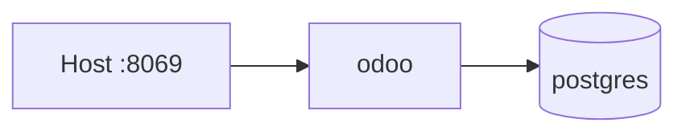
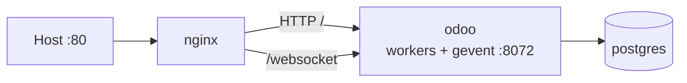

# KV Odoo — Docker deployment

This folder packages **Odoo 18** from the repository root (`addons/`, `custom/`, `odoo/`, `odoo-bin`) with **PostgreSQL 17** for local or server deployment (matches typical host `pg_dump` format).

## Architecture

### Development (`docker-compose.yml`)



### Production (`docker-compose.yml` + `docker-compose.prod.yml`)



| Component | Role |
|-----------|------|
| `db` | PostgreSQL; credentials from `.env` |
| `odoo` | Built from `deploy/Dockerfile`; config from `odoo.conf.template` |
| `nginx` | Reverse proxy, WebSocket bus, 200MB uploads (production compose only) |
| `odoo-web-data` | Odoo `data_dir` (filestore, sessions) |
| `odoo-db-data` | Database files |

Custom modules: `custom/kv_hr_contract`, `custom/hr_employee_kv`.

## Your current database (non-Docker)

On this machine you already have:

| Item | Location |
|------|----------|
| PostgreSQL | `localhost:5432`, database **`odoo`**, user **`debian1`** (see `config/odoo.conf`) |
| Filestore | `~/.local/share/Odoo/filestore/odoo` (~1.9 GB attachments) |
| Odoo version | 18.0 (modules in DB match this repo) |

The Docker stack does **not** use that Postgres automatically. It starts a **new** PostgreSQL instance in the `db` container (volume `odoo-db-data`) and an empty filestore in `odoo-web-data`. To keep your data, migrate once.

### Backup host DB (database only, fast)

```bash
cd deploy
./scripts/backup-host-db.sh
```

Creates `deploy/backup/odoo-YYYY-MM-DD_HHMMSS.dump` and updates `deploy/backup/host-odoo.dump`. Does **not** copy filestore.

### Migrate host DB → Docker

Requires Docker access (`docker` group or `sudo`). DB-only (no filestore):

```bash
cd deploy
cp .env.example .env   # set POSTGRES_* and ODOO_ADMIN_PASSWD
SKIP_FILESTORE=1 ./scripts/migrate-host-db.sh
```

Uses `deploy/backup/host-odoo.dump` by default, or pass `DUMP_FILE=backup/odoo-....dump`.

With filestore (slow, ~1.9 GB on this machine):

```bash
./scripts/migrate-host-db.sh
```

Steps:

1. Restore custom-format dump into container Postgres (database name `odoo`)
2. Optionally copy filestore into `odoo-web-data`
3. Start Odoo

For production nginx stack, run:

```bash
COMPOSE_FILES="-f docker-compose.yml -f docker-compose.prod.yml" ./deploy/scripts/migrate-host-db.sh
```

**Master password:** Docker uses `ODOO_ADMIN_PASSWD` from `.env` (not `config/odoo.conf`). Set it to your existing master password if you use the database manager, or keep logins via the normal Odoo web UI (unchanged in the restored DB).

**Optional:** pin a single database in `odoo.conf.template`:

```ini
db_name = odoo
dbfilter = ^odoo$
```

### Other options

| Approach | When to use |
|----------|-------------|
| **Migrate (recommended)** | Move fully into Docker; host Postgres can be stopped later |
| **Expose container Postgres** | Rare; add `ports: ["5432:5432"]` on `db` only for debugging |
| **Odoo → host Postgres** | `db` service removed; `db_host` = host IP + `extra_hosts` — couples container to host DB |

Backups after migration:

```bash
docker compose exec -T db pg_dump -U odoo -Fc odoo > deploy/backup/odoo-$(date +%F).dump
```

## Prerequisites

- Docker Engine 24+ and Docker Compose v2
- Enough disk for the image build (Odoo dependencies are large on first build)

## Boot on startup (systemd)

After install on this server:

```bash
sudo cp deploy/kv-odoo-docker.service /etc/systemd/system/
sudo systemctl daemon-reload
sudo systemctl enable --now kv-odoo-docker.service
```

Host PostgreSQL (`postgresql@17-main`) can be stopped if you only use the DB inside Docker:

```bash
sudo systemctl stop postgresql@17-main
sudo systemctl disable postgresql@17-main
```

## Quick start (development)

```bash
cd deploy
cp .env.example .env
# Edit .env — set POSTGRES_PASSWORD and ODOO_ADMIN_PASSWD

docker compose up --build -d
```

Open `http://localhost:8069` (or `ODOO_HTTP_PORT`).

**First database:** use the Odoo web UI “Create database”, or set `ODOO_INIT_MODULES` once in `.env` and recreate the `odoo` container.

## Production (nginx + workers)

```bash
cd deploy
cp .env.example .env
# Set secrets; tune ODOO_WORKERS (e.g. 2 * CPU + 1)

docker compose -f docker-compose.yml -f docker-compose.prod.yml up --build -d
```

Open `http://localhost` (or `NGINX_HTTP_PORT`). Odoo is **not** published on the host; only nginx is.

| Setting | Default (prod compose) | Notes |
|---------|------------------------|--------|
| `ODOO_WORKERS` | `4` | HTTP workers; use `0` only for dev |
| `ODOO_MAX_CRON_THREADS` | `2` | Scheduled actions |
| `ODOO_PROXY_MODE` | `True` | Required behind nginx |
| `ODOO_GEVENT_PORT` | `8072` | Bus / WebSocket |
| `limit_memory_*` | see `.env.example` | Lower if the host has less RAM |

**TLS (needed for attendance GPS on phones):** generate a cert, then add the TLS overlay. Browsers warn once on the self-signed cert; after Proceed the page is HTTPS and geolocation works.

```bash
cd deploy
./scripts/generate-tls-cert.sh
docker compose -f docker-compose.yml -f docker-compose.dev.yml -f docker-compose.tls.yml up -d
```

Open `https://<lan-ip>/attendance` (port 443) or, without Docker/root, the user-space proxy:

```bash
systemctl --user enable --now odoo-https-proxy.service
```

that listens on `https://<lan-ip>:8443/attendance`.

## Development (live-mounted code)

```bash
cd deploy
docker compose -f docker-compose.yml -f docker-compose.dev.yml up --build
```

Mounts `addons/`, `custom/`, `odoo/`, and `utils/` from the host.

## Configuration

| File | Purpose |
|------|---------|
| `.env` | Secrets, ports, worker tuning |
| `odoo.conf.template` | Odoo options; rendered by `entrypoint.sh` |
| `nginx/default.conf` | Upstream to `odoo:8069` and `odoo:8072` |
| `entrypoint.sh` | Defaults for dev (`workers=0`); prod overrides via compose |

Optional on the `odoo` service:

- `ODOO_INIT_MODULES` — `-i` on start (empty DB)
- `ODOO_UPDATE_MODULES` — `-u` on start

```bash
docker compose exec odoo bash -c 'gosu odoo python3 /opt/odoo/odoo-bin shell -c /etc/odoo/odoo.conf -d YOUR_DB_NAME'
```

## Production checklist

1. **Secrets** — strong `POSTGRES_PASSWORD` and `ODOO_ADMIN_PASSWD`.
2. **Workers** — `ODOO_WORKERS` ≈ `2 * CPU + 1`; ensure host RAM fits soft/hard limits.
3. **TLS** — enable HTTPS in `nginx/default.conf` or use an external proxy.
4. **Backups** — `pg_dump` + volume `odoo-web-data`.
5. **Updates** — rebuild image; `ODOO_UPDATE_MODULES` when upgrading addons.

## PDF / fonts

Contract PDFs resolve paths from the module (`custom/kv_hr_contract/report/`) and fonts under `utils/font/`. Works in Docker (`/opt/odoo`) and on a local checkout without hardcoded home directories.

## Local `config/odoo.conf`

Non-Docker development on this machine. Docker uses `deploy/odoo.conf.template` instead.

## Troubleshooting

| Symptom | Check |
|---------|--------|
| `odoo` exits on start | `docker compose logs odoo` — `.env` or DB health |
| Live chat / bus flaky in prod | nginx `/websocket` → `odoo:8072`; `proxy_mode = True` |
| 502 from nginx | `docker compose ps`; Odoo still starting |
| Module not found | `addons_path` in `/etc/odoo/odoo.conf` |
| PDF font error | `utils/font/font-times-new-roman/` present in image |
